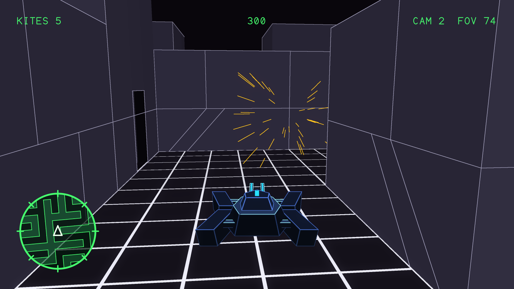
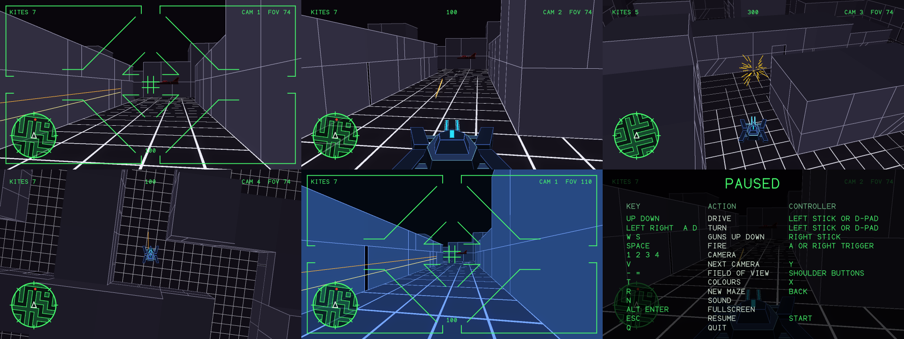

# space-paranoids

A first-person tank game in C++17. Drive a slow, heavy tank through a generated 3D maze and shoot down the kites flying its corridors. Everything is made by code: the picture comes from a software renderer and the sound from AdLib-style FM synthesis, with no image or audio files loaded at run time.



## Install

[Releases](https://github.com/ross-newman/space-paranoids/releases) have a `.deb` for Ubuntu 24.04, a `.deb` for Ubuntu 26.04 and a Windows installer. On Ubuntu:

```bash
sudo apt install ./space-paranoids_*.deb
space-paranoids
```

## Build from source

You need a C++17 compiler, CMake 3.16 or newer and SDL2 (`libsdl2-dev` on Ubuntu). Everything else is in this repo.

```bash
make        # build everything into build/
make run    # build and play
make test   # build and run every check
make clean  # delete what was built
```

The game itself is `build/space-paranoids`.

To make a package, run `cpack -G DEB` on Linux or `cpack -G NSIS` on Windows in the build directory. The version is in [VERSION](VERSION). Pushing a tag such as `v0.2.0` makes GitHub build, test and install all three packages, then attach them to a release of that tag.

## Playing

A terminal types out the mission and leaves its cursor flashing. Press any key to start, or press one during the typing to skip to the end. Clear every kite to move on to the next maze, which has two more. Kites do not fight back yet, so a game cannot be lost.

The tank is slower than the kites, so wait for them to come to you rather than chasing them. A shot has to come in at a kite's height, and shots can pass over low walls.

| Key | Action |
|---|---|
| Up, Down | Forward, back |
| Left/A, Right/D | Turn |
| W, S | Guns up, down |
| Space | Fire |
| 1, 2, 3, 4 | Cockpit, chase, high and overhead cameras |
| V | Next camera |
| -, = | Field of view |
| T | Charcoal or blue colours |
| R | New maze |
| N | Sound on or off |
| Alt+Enter | Fullscreen |
| Esc | Pause and show the keys |
| Q | Quit, from the pause screen |

Controllers and joysticks can be plugged in at any time, and any button except a trigger gets past the opening screen. There is no quit button on a controller.

| Action | Controller | Plain joystick |
|---|---|---|
| Drive | Left stick or d-pad | Stick or hat |
| Guns up, down | Right stick | Axis 3 |
| Fire | A or right trigger | Button 0 |
| Next camera | Y | Button 1 |
| Colours | X | Button 2 |
| New maze | Back | Button 3 |
| Pause | Start | Button 4 |
| Field of view | Shoulder buttons | |



## Display

The opening screen is drawn at the full size of the window. The maze is too, up to 1200 lines. Past that it is drawn at 1200 lines and the graphics card smooths it up, because the renderer runs on the CPU. On 24 cores this holds about 50 frames a second on a 3840×2400 screen. To trade speed for sharpness, change `kMazeLines` in [src/maze_main.cpp](src/maze_main.cpp).

## Sound

Effects and the engine drone come from the AdLib library in [adlib/](adlib). The music in [src/score.cpp](src/score.cpp) is an original piece limited to what the chip could do: nine channels, two operators to a note and the OPL2's four waveforms. It is one 38.4 second loop in two layers. The action layer fades in as kites get close.

`make test` writes the music to `build/score_patrol.wav` and `build/score_full.wav`.

## Checks

`make test` runs these. None of them need a display, a sound device or a controller.

| Program | What it checks |
|---|---|
| `maze_preview [out.png [action.png]]` | A bot clears 40 mazes through the real controls and shooting code, aim is shown to matter, and frames are timed at sizes up to 3840×2400. Draws the game to a PNG, and with a second name the picture at the top of this page. |
| `terminal_preview [out.png]` | The opening screen types on and its cursor flashes at the end. |
| `vehicle_preview [out.png]` | Every vehicle mesh is sound. Draws them to a PNG. |
| `score_check [directory]` | The music loops cleanly, does not clip, and has the right length. |
| `pad_test [seconds]` | The controller code works with virtual devices. With a number it watches your real devices for that many seconds instead. |

The engine has its own tests, which are built when `engine/` is configured on its own:

```bash
cmake -S engine -B build-engine
cmake --build build-engine --target softrender_tests
./build-engine/softrender_tests
```

## Layout

| Path | Contents |
|---|---|
| [src/maze.h](src/maze.h) | The maze plan, tank movement, cameras and maze geometry |
| [src/battle.h](src/battle.h) | Kites, shots, explosions, the HUD, radar and pause screen |
| [src/terminal.h](src/terminal.h) | The opening screen and its dot font |
| [src/vehicles.h](src/vehicles.h) | The crawler (the tank), kite and runner models |
| [packaging/](packaging) | The icon, desktop entry and copyright notice of the packages |
| [.github/workflows/](.github/workflows) | The builds of the packages |
| [src/score.h](src/score.h) | The music |
| [src/audio.h](src/audio.h) | All sound on an SDL audio device |
| [src/pad.h](src/pad.h) | Controllers and joysticks |
| [src/maze_main.cpp](src/maze_main.cpp) | The window, the keys and the game loop |
| [tools/](tools) | The checks above |
| [adlib/](adlib) | The AdLib synthesizer, mixer and effects, copied from the `coriolis` project |
| [engine/](engine) | `softrender`, a generic software 3D renderer with nothing game-specific in it. See [engine/README.md](engine/README.md). |
| [images/](images) | Preview pictures and the runner mesh. The game loads none of them. |

Nothing builds `src/main.cpp`, `src/game.cpp`, `src/game.h`, the root `game.h` or `src/coriolis_engine/`. They are left over from earlier work.

## Credits

The runner model is the light cycle mesh from [gltron](https://github.com/laanwj/gltron), kept as `images/runner.obj` and [src/runner.cpp](src/runner.cpp). gltron is under the GNU GPL version 2, which still applies to the mesh in those two files. Runners are not in the game yet, so only `vehicle_preview` links that code, and neither the game nor its packages contain it.

`adlib/` and `engine/` are under the MIT licence, except that the first effects in `adlib/src/adlib_synth.cpp` are derived from the Atlas project, Copyright (c) 2026 Astute Systems PTY LTD, under that project's licence.
